# Gadget Exchange Point (বসুন্ধরা সিটি): অভিযোগ ও প্রমাণ

১৭ অক্টোবর ২০২৬। বসুন্ধরা সিটি শপিং মলের **Gadget Exchange Point** (বেসমেন্ট-২, দোকান নং ৪৭)-এ একটি ব্যবহৃত Google Pixel 8a আর একটি Anker চার্জার দেখছিলাম। দোকান থেকে অনেক সময় নিয়ে, অনেক ভালো করে বুঝিয়ে বলা হলো: ফোনটা **১০০% অথেনটিক**, চার্জারটা **১০০% অরিজিনাল**, সাথে **১৮ মাসের অফিসিয়াল ওয়ারেন্টি**। এত নিশ্চিত হয়ে বলায় তাদের বিশ্বাস করেছিলাম, আর ৳৩০,৫০০ দিয়ে দুটোই কিনে ফেলি।

বাসায় এসে নিজে যাচাই করতেই একের পর এক সত্য বেরিয়ে এল। পরে বুঝলাম, আমি প্রতারিত হয়েছি।

কী ঘটেছে আর তার সব প্রমাণ এই পাতায় একসাথে রাখা হলো, যাতে যে কেউ নিজে দেখে বিচার করতে পারেন।

— Md. Sishir Rahman Siam (ক্রেতা)

## সংক্ষেপে: যা বলা হয়েছিল, আর যা পেলাম

| দোকান যা বলেছিল | যাচাই করে যা পেলাম |
|---|---|
| ফোন **১০০% অথেনটিক**, মেমোতে রঙ লেখা **"White"** | ফোনের মাদারবোর্ডের IMEI Google-এর রেকর্ডে **Pixel 8a Obsidian (কালো)**। কালো ফোনের ভেতরের অংশ সাদা বডিতে বসানো, যা আমাকে জানানো হয়নি। [প্রমাণ ↓](#অভিযোগ-১-বডি-বদলানো-ফোন-বিক্রি-হয়েছে-white-বলে) |
| চার্জার **১০০% অরিজিনাল**, নতুন | বক্সের scratch code আমার কেনার দুই মাসেরও বেশি আগে (১১ আগস্ট ২০২৬) কেউ যাচাই করে ফেলেছে। Anker-এর সাইট শুধু বক্সের কোড যাচাই করে, চার্জার নিজে নয়। আর চার্জারের গায়ে কোনো QR code নেই, তাই বক্সের কোড এই চার্জারেরই কিনা মেলানো যায় না। হতে পারে চার্জারটা কপি, আর অন্য কোনো চার্জারের কোড কপি করে এই বক্সে বসানো হয়েছে। পণ্যটি চীনের বাজারের। [প্রমাণ ↓](#অভিযোগ-৩-আগেই-যাচাই-করা-চীনের-বাজারের-চার্জার) |
| চার্জারে **১৮ মাসের অফিসিয়াল ওয়ারেন্টি** | মেমোতে কোনো ওয়ারেন্টি লেখা নেই। |
| **"এটার দাম বাইরে কাউকে বলবেন না, দামটা না লিখি"** | ফলে চার্জারের মেমোতে না আছে দাম, না আছে ওয়ারেন্টি। পরে অভিযোগ করার মতো লিখিত কিছুই রাখা হয়নি। |
| মেমোতে ছাপা: ১০ দিনের মধ্যে হার্ডওয়্যার সমস্যা হলে **রিপ্লেসমেন্ট** | রিপ্লেসমেন্ট হিসেবে যে ফোন দিতে চাইল, তার ব্যাক কভার নষ্ট। ফোন ফেরত নিয়ে ৳২৯,০০০-এর বদলে প্রথমে দিতে চাইল মাত্র **৳২৬,০০০** (৳৩,০০০ কেটে)। অনেক বাকবিতণ্ডার পর দিল ৳২৮,০০০, তবুও **৳১,০০০ কেটে রাখল**। [প্রমাণ ↓](#অভিযোগ-২-ফেরতের-সময়-১০০০-কেটে-রাখা) |

## দোকানের তথ্য

| | |
|---|---|
| নাম | Gadget Exchange Point |
| ঠিকানা | Basement #2, Shop #47, Bashundhara City Shopping Mall, Panthapath, Dhaka-1215 |
| ফোন | 01963-167260, 01982-199855 |
| প্রোপ্রাইটর | Md. Monir Hosen (ভিজিটিং কার্ড অনুযায়ী) |
| Facebook পেজ | [facebook.com/trustpoint2019](https://www.facebook.com/trustpoint2019) |

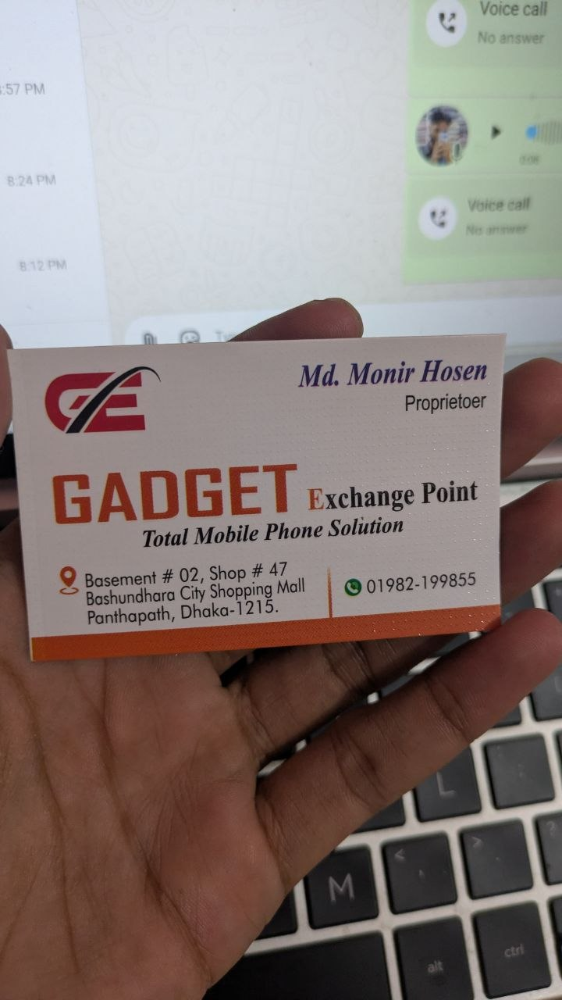

## ঘটনাক্রম

| তারিখ | কী হয়েছে |
|---|---|
| ১৭ অক্টোবর ২০২৬ | দোকান অনেক বুঝিয়ে বলে, ফোন ১০০% অথেনটিক আর চার্জার ১০০% অরিজিনাল, সাথে চার্জারে ১৮ মাসের অফিসিয়াল ওয়ারেন্টি। বিশ্বাস করে Pixel 8a কিনি (মেমো নং ২৭৩১, ৳২৯,০০০)। সাথে Anker Zolo 30W চার্জার ও Google Type-C ক্যাবল (মেমো নং ১০১৪, ৳১,৫০০)। চার্জারের মেমো লেখার সময় দোকান বলে, *"এটার দাম বাইরে কাউকে বলবেন না, দামটা না লিখি।"* তাই এই মেমোতে কোনো দাম নেই। |
| ১৮ অক্টোবর ২০২৬ | ফোনের Fastboot barcode থেকে মাদারবোর্ডের IMEI বের করে Google Store-এ মিলাই। Google দেখায়, এই IMEI একটি **Pixel 8a Obsidian** (কালো) ফোনের। |
| ১৯ অক্টোবর ২০২৬ | দোকানে প্রমাণ দেখাই। দোকান রিপ্লেসমেন্ট হিসেবে আরেকটি ফোন দিতে চায়, কিন্তু সেটিও ফ্রেশ ছিল না, ব্যাক কভার নষ্ট। শেষে দোকান ফোন ফেরত নেয়, কিন্তু প্রথমে দিতে চায় মাত্র ৳২৬,০০০। অনেক বাকবিতণ্ডার পর ৳২৮,০০০ নগদ ফেরত দেয়। কোনো রিসিট দেওয়া হয়নি, মূল মেমোও দোকান রেখে দেয়। |
| ২১ অক্টোবর ২০২৬ | চার্জারের বক্সের কোড Anker-এর সাইটে যাচাই করি। দেখা যায় কোডগুলো আমার কেনার আগেই যাচাই করা হয়েছিল। |

## অভিযোগ ১: বডি বদলানো ফোন, বিক্রি হয়েছে "White" বলে

দোকান আমাকে বলেছিল ফোনটা ১০০% অথেনটিক। ফোনটি যে ব্যবহৃত, তা মেমোতে লেখা ছিল, আমার অভিযোগ সেটা নিয়ে নয়। অভিযোগ হলো, ফোনের বডি (হাউজিং) বদলানো হয়েছে, আর সেটা জানানো হয়নি।

তিনটি আলাদা উৎস একই কথা বলে:

1. **দোকানের মেমো** (নং ২৭৩১): হাতে লেখা `pixel 8A #128Gb #White #With out Box IMEI: 351163524193647 (Used Divice)`
2. **ফোনের হার্ডওয়্যার** (Fastboot Mode → Barcodes): IMEI `351163524193647`, Serial `45301JEKB08680`। এটা মাদারবোর্ড নিজে দেখায়, কোনো স্টিকার বা বক্স থেকে নয়। মেমোর IMEI-র সাথে হুবহু মেলে।
3. **Google-এর রেকর্ড** (Google Store → Repair → IMEI দিয়ে খোঁজ): এই IMEI-র ফোন **"Pixel 8a Obsidian 128GB (Unlocked)"**।

Pixel 8a চারটি রঙে আসে: Obsidian (কালো), Porcelain (সাদা), Bay (নীল), Aloe (সবুজ)। Google-এর রেকর্ডে ফোনটি Obsidian, অথচ আমার হাতে দেওয়া ফোনের বডি সাদা।

**দোকানের মেমো (নং ২৭৩১): "White", IMEI 351163524193647**

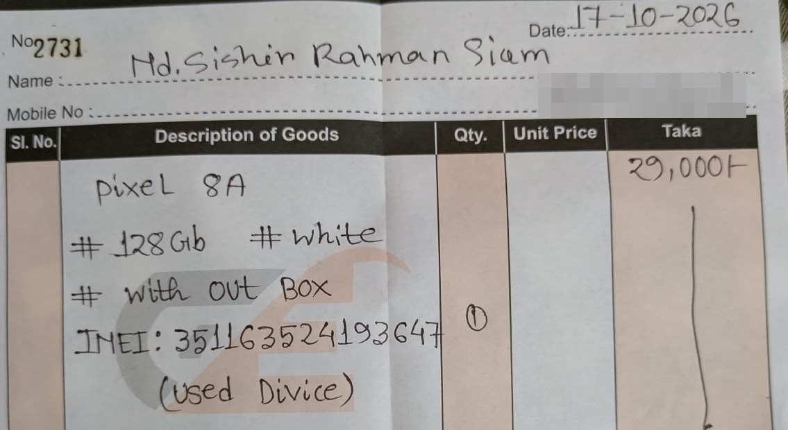

[পুরো মেমো দেখুন](evidence/phone/01-invoice-no-2731.jpg)

**ফোনের হার্ডওয়্যার: Fastboot barcode ও Fastboot Mode**

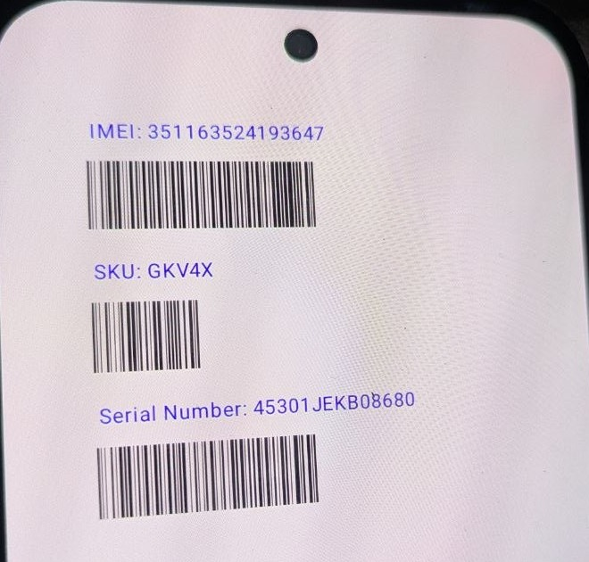 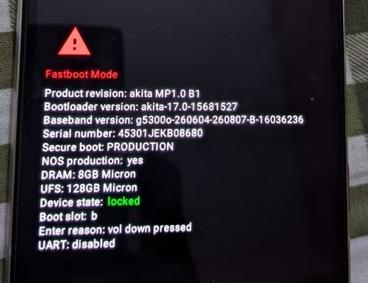

**Google Store-এ IMEI দিয়ে খোঁজ: "Pixel 8a Obsidian"**

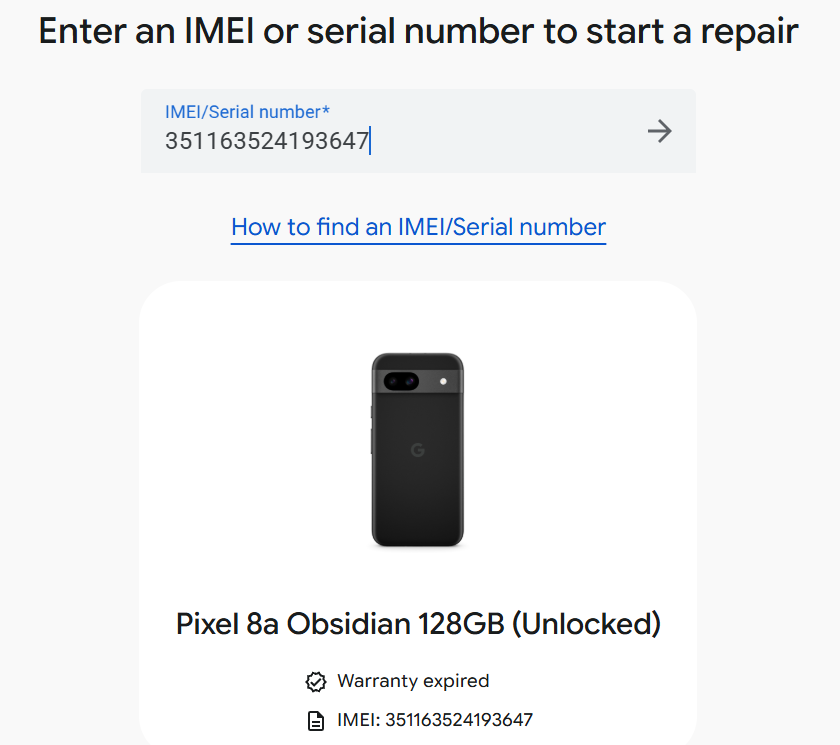

[পূর্ণ স্ক্রিনশট দেখুন](evidence/phone/04-google-store-imei-lookup-obsidian.png)

**হাতে পাওয়া ফোন: সাদা বডি**

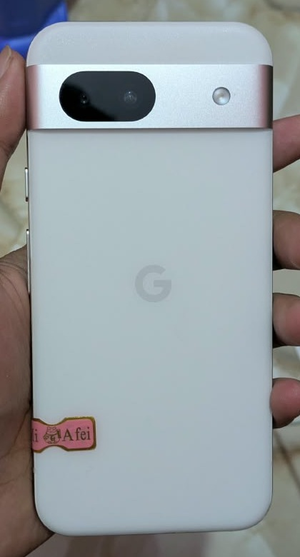 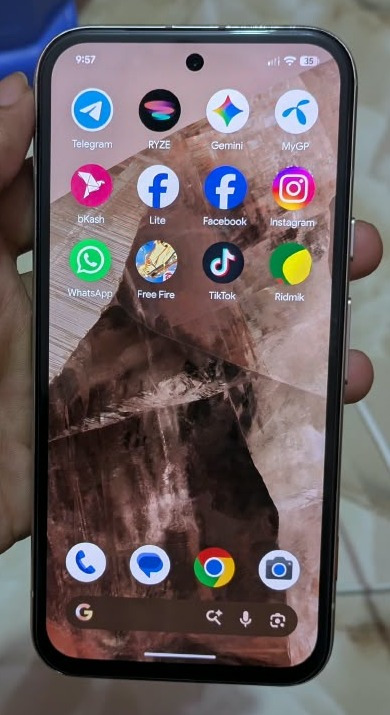

## অভিযোগ ২: ফেরতের সময় ৳১,০০০ কেটে রাখা

- আমি দিয়েছি ৳২৯,০০০। ফোন ফেরত নেওয়ার সময় দোকান প্রথমে দিতে চায় মাত্র ৳২৬,০০০, অর্থাৎ ৳৩,০০০ কেটে রাখতে চায়। অনেক বাকবিতণ্ডার পর ফেরত দেয় ৳২৮,০০০ (নগদ, ১৯ অক্টোবর)। কোনো রিসিট দেওয়া হয়নি, মূল মেমোও দোকান রেখে দিয়েছে।
- দোকানের মেমোতেই লেখা: *"১০ দিনের মধ্যে হার্ডওয়্যার (পার্টস জনিত) সমস্যা থাকলে কর্তৃপক্ষ সমাধান করতে না পারলে রিপ্লেসমেন্ট এর আওতাভুক্ত হবে।"* দোকান রিপ্লেসমেন্ট দিতে চেয়েছিল, কিন্তু যে ফোনটি দিতে চেয়েছিল সেটিও ফ্রেশ ছিল না, ব্যাক কভার নষ্ট।

  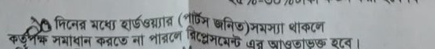

- মেমোতে আরেকটি শর্ত আছে: *"ক্রয়কৃত মোবাইল এর মডেল পরিবর্তন বা টাকা ফেরত এর ক্ষেত্রে ২৫%-৩০% টাকা কর্তন করা হবে।"* আমার বক্তব্য: এই শর্ত ক্রেতা নিজে মত বদলালে খাটতে পারে। কিন্তু এখানে ফেরত হয়েছে দোকানের ভুল বর্ণনার কারণে, আর দোকান ঠিকঠাক রিপ্লেসমেন্টও দিতে পারেনি। তাই এই টাকা কাটার কোনো যুক্তি নেই।

  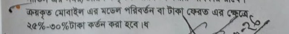

## অভিযোগ ৩: আগেই যাচাই করা, চীনের বাজারের চার্জার

- দোকান বলেছিল চার্জার ১০০% অরিজিনাল, সাথে ১৮ মাসের অফিসিয়াল ওয়ারেন্টি।
- মেমো নং ১০১৪-তে শুধু লেখা "Anker Zolo 30W (1)"। দাম বা ওয়ারেন্টির কোনো উল্লেখ নেই। দাম নেওয়া হয়েছে ৳১,৫০০ (Google Type-C ক্যাবলসহ)। মেমো লেখার সময় দোকান বলে, *"এটার দাম বাইরে কাউকে বলবেন না, দামটা না লিখি।"*
- বক্সের **scratch code** [anker.com/verify](https://www.anker.com/verify)-এ যাচাই করলে দেখায়: *"This code has been verified before on the following date: 2026-08-11 22:58:45"*। আমি কিনেছি ১৭ অক্টোবর। তার দুই মাসেরও বেশি আগে কেউ এই কোড যাচাই করেছে।
- বক্সের **QR code**-এর কোডও আগেই যাচাই করা: *2025-03-25 23:41:15*।
- **চার্জারটা কি আদৌ আসল?** Anker-এর সাইট "Authentic" বলে শুধু বক্সের কোডকে, চার্জারকে নয়। চার্জারের গায়ে কোনো QR code নেই, তাই বক্সের কোড যে এই চার্জারেরই, তা মেলানোর উপায় নেই। নকল পণ্যে সাধারণত একটা আসল কোড কপি করে অনেক বক্সে বসানো হয়, আর সেজন্যই কোড "আগেই যাচাই করা" দেখানো একটা বড় সতর্ক সংকেত। আমার সন্দেহ, চার্জারটা কপি, আর অন্য কোনো চার্জারের কোড কপি করে এই বক্সে বসানো হয়েছে।
- চার্জারটা আসল হলেও, আগেই যাচাই করা কোড ইঙ্গিত দেয় যে এটা "নতুন" হিসেবে বিক্রির আগেই খোলা বা ব্যবহার করা হয়েছিল।
- বক্স ও চার্জার চীনের বাজারের: লেবেল চাইনিজ ভাষায়, মডেল A2698, CCC সার্টিফিকেশন, চীনের হটলাইন 400-0550-036, চাইনিজ ফ্ল্যাট-পিন প্লাগ। বক্সে লেখা "保修时间: 18个月质保" (১৮ মাস ওয়ারেন্টি), যা চীনের বাজারের পণ্যের ওয়ারেন্টি। দোকান নিজে কোনো লিখিত ওয়ারেন্টি দেয়নি।

**চার্জারের মেমো (নং ১০১৪): দাম বা ওয়ারেন্টি লেখা নেই**

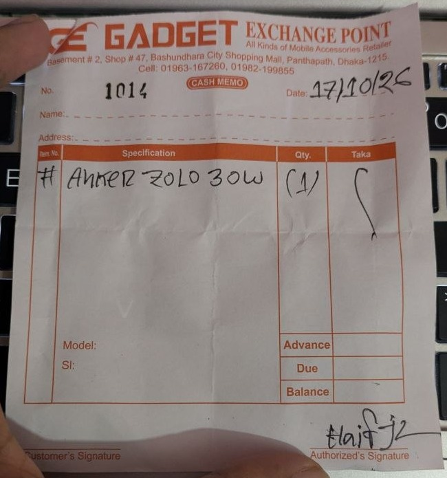

**Scratch code: আগেই যাচাই করা, ২০২৬-০৮-১১**

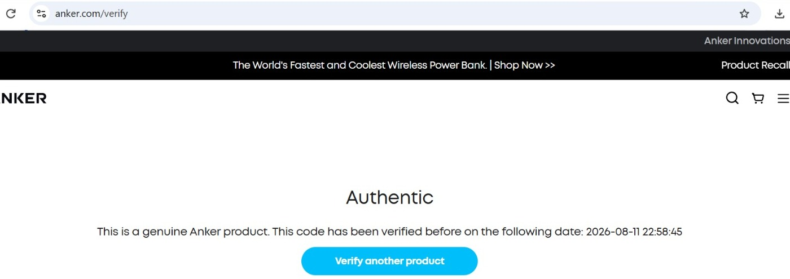

যাচাই করেছি ২১ অক্টোবর ২০২৬, রাত ১১:২৮। [পূর্ণ স্ক্রিনশট দেখুন](evidence/charger/02-anker-verify-scratch-code-2026-08-11.jpg) (নিচে তারিখ-সময় দেখা যায়)

**QR code: আগেই যাচাই করা, ২০২৫-০৩-২৫**

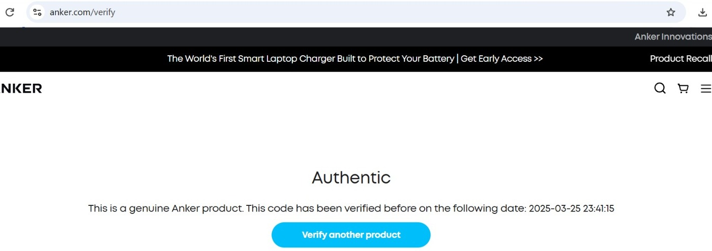

যাচাই করেছি ২১ অক্টোবর ২০২৬, রাত ১১:২৭। [পূর্ণ স্ক্রিনশট দেখুন](evidence/charger/03-anker-verify-qr-code-2025-03-25.jpg)

**বক্স: সামনে সিকিউরিটি লেবেল, পেছনে চাইনিজ লেবেল**

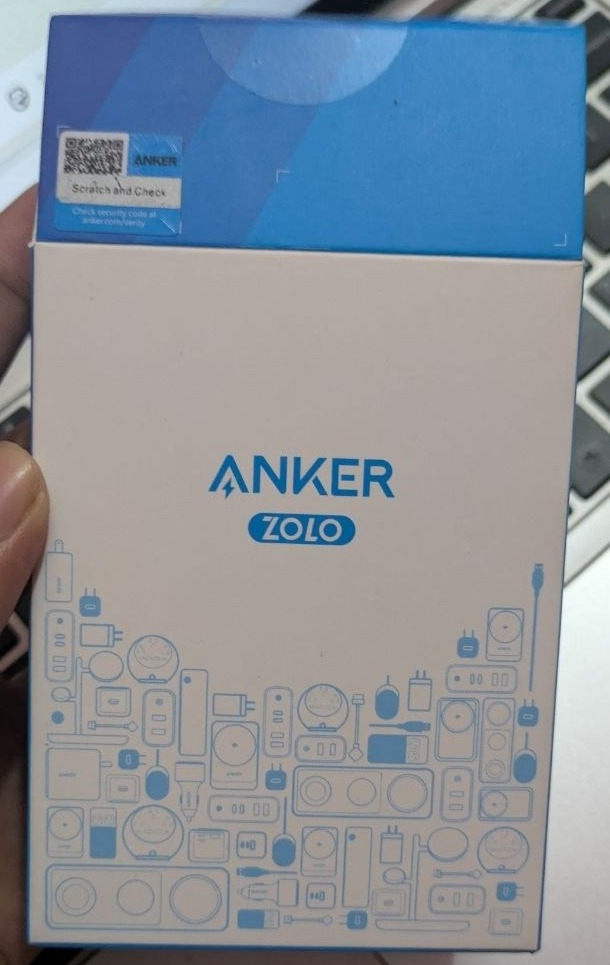 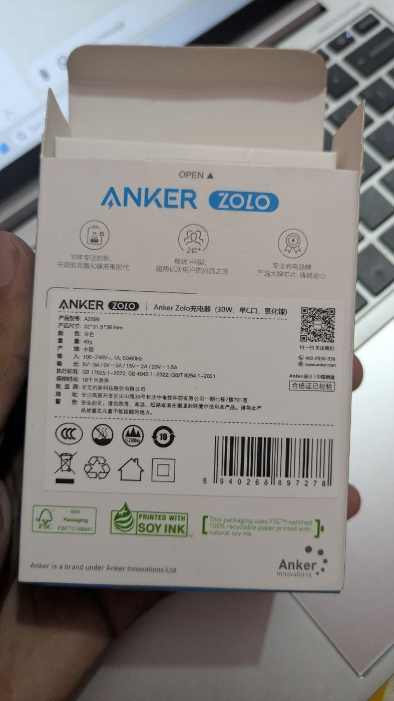

লেবেলের কাছ থেকে: মডেল A2698, 产地 (উৎপাদন): 中国 (চীন), 保修时间 (ওয়ারেন্টি): 18个月质保 (১৮ মাস)

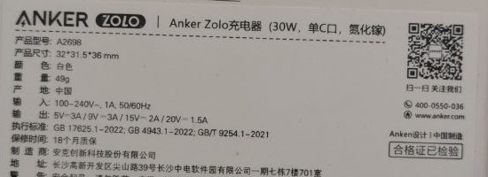

**চার্জার: গায়ে কোনো QR code নেই, চাইনিজ ফ্ল্যাট-পিন প্লাগ**

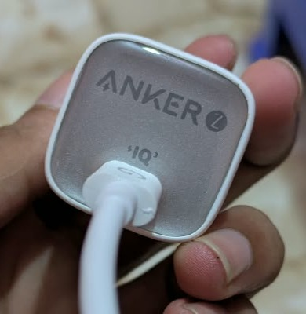 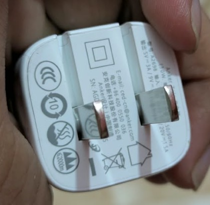

## এই ফোনটি চিনে রাখুন

ফোনটি এখন দোকানের কাছে, আবার বিক্রি হতে পারে। নিচের IMEI বা Serial-এর কোনো Pixel 8a সাদা বডিতে পেলে জানবেন, এর বডি বদলানো।

| | |
|---|---|
| মডেল | Google Pixel 8a (GKV4X), 8GB / 128GB |
| IMEI 1 | `351163524193647` |
| IMEI 2 | `351163524193654` |
| Serial | `45301JEKB08680` |
| Google-এর রেকর্ডে রঙ | Obsidian (কালো) |
| বিক্রির সময় বডি | সাদা |

## আমার দাবি

1. ফোন ফেরতের সময় কেটে রাখা ৳১,০০০ ফেরত দিতে হবে।
2. চার্জার ও ক্যাবল ফেরত নিয়ে পুরো ৳১,৫০০ ফেরত দিতে হবে।

দোকান নিজে যোগাযোগ করে সমাধান না করলে মেমো ও এই প্রমাণগুলোসহ জাতীয় ভোক্তা-অধিকার সংরক্ষণ অধিদপ্তরে (DNCRP) অভিযোগ দায়ের করব।

## কেনার আগে যা যাচাই করবেন

- **ব্যবহৃত Pixel:** ফোন বন্ধ করে Power + Volume Down চেপে ধরে Fastboot Mode-এ যান, Volume বাটন দিয়ে Barcodes বেছে IMEI দেখুন। এরপর [Google Store-এর Repair পেজে](https://store.google.com/us/repair) সেই IMEI দিন (Google অ্যাকাউন্টে সাইন ইন লাগতে পারে)। ফোনের আসল মডেল ও রঙ দেখাবে, হাতের ফোনের সাথে মিলিয়ে নিন।
- **Anker বা অন্য ব্র্যান্ডের এক্সেসরিজ:** টাকা দেওয়ার আগে দোকানেই scratch code যাচাই করুন। "verified before" দেখালে নেবেন না।
- **ওয়ারেন্টি ও দাম:** মুখের কথায় ভরসা না করে মেমোতে লিখিয়ে নিন। "দাম বাইরে বলবেন না, তাই লিখছি না" শুনলে সাবধান হোন।
- **টাকা ফেরতের শর্ত:** সই করার আগে মেমোর নিচের শর্তগুলো পড়ে নিন।

## শেষ কথা

দোকানের কথায় বিশ্বাস করেছিলাম, কারণ তারা অনেক বুঝিয়ে, অনেক নিশ্চিত হয়ে বলেছিল। বসুন্ধরা সিটির মতো নামকরা শপিং মলে এমন অভিজ্ঞতা কারও হওয়া উচিত নয়। "১০০% অথেনটিক" বা "১০০% অরিজিনাল" শুনেই বিশ্বাস করবেন না, নিজে যাচাই করে তারপর কিনুন।

**এই পাতাটি শেয়ার করুন, যাতে আর কেউ একইভাবে না ঠকেন।**

## ছবি সম্পর্কে

সব ছবি আসল। পড়তে সুবিধার জন্য কিছু ছবি ক্রপ করা, আর Fastboot barcode-এর ছবিটা সোজা করে ঘোরানো হয়েছে। স্ক্রিনশট ও মেমোর পূর্ণ ছবি লিংকে দেওয়া আছে।

শুধু একটি জিনিস ঢাকা হয়েছে: মেমো নং ২৭৩১-এ আমার মোবাইল নম্বর।

মূল, না-ঢাকা ছবিগুলো আমার কাছে আছে। দরকার হলে কর্তৃপক্ষকে দেখাতে পারব।
